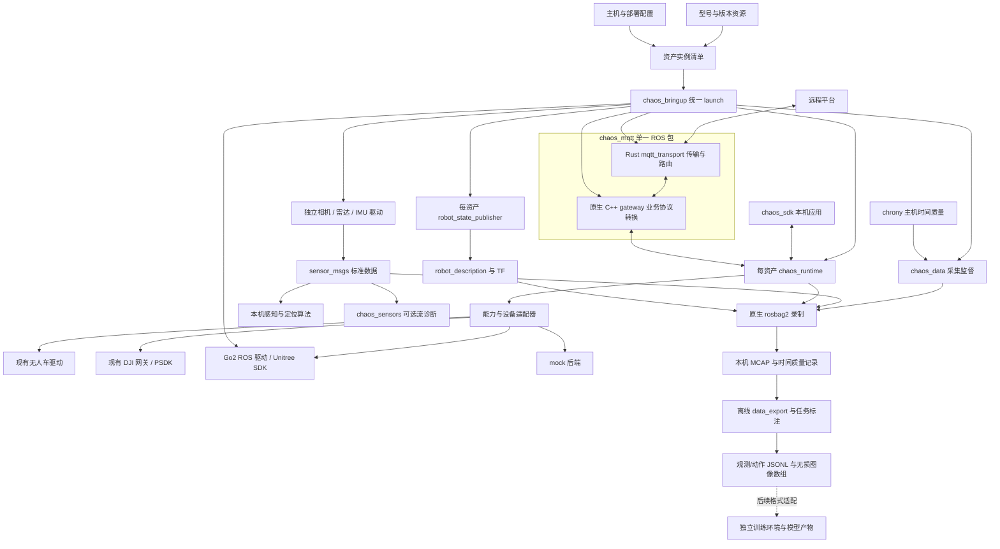

# Chaos ROS 2 多机器人框架架构

目标平台：ROS 2 Jazzy。设计日期：2026-10-16。

本框架以型号资源和资产实例配置组织无人车、无人机与机器狗。统一 launch 根据部署主机选择资产和设备后端，机器人运行时对外提供共同的状态和控制接口，SDK 与 MQTT API 使用同一能力契约。

部署位置为每台机器人上的 Linux 计算机，目标环境是 Ubuntu 24.04 / ROS 2 Jazzy，支持按目标平台分别构建 x86_64 和 ARM64 产物。机载 `edge.launch.py` 明确绑定一个真实资产；多 mock 示例属于开发验证。平台通过 MQTT 调用各设备能力，机载框架本身无需运行中心车队管理服务。具体安装与服务归属见 [机载部署说明](onboard-deployment.md)。

框架保留已有的底盘驱动、导航实现和 PSDK，在其边界增加适配器。参考依据与采用范围见 [Kuavo 参考核对](upstream-reference.md)。

## 1. 分层与职责



| 包 | 责任 |
|---|---|
| `chaos_core` | 共享值对象、错误类型与时间原语；无 ROS 依赖的头文件库，被其他包单向依赖 |
| `chaos_assets` | 加载型号和实例、合并配置、校验资源与部署约束、生成解析结果 |
| `chaos_bringup` | 根据解析结果组合本机启动图，设置资产命名空间并选择后端 |
| `chaos_interfaces` | 定义机器人状态、能力和控制的 ROS 消息、服务等契约 |
| `chaos_runtime` | 每资产的公共运行时、适配器契约和独立 Go2 ROS 驱动 |
| `chaos_sdk` | 面向业务程序封装统一接口的原生异步客户端 |
| `chaos_mqtt` | 内置 Rust MQTT / ROS 2 传输与原生 C++ 业务网关，将外部命令、请求编号、结果映射到统一 ROS 接口 |
| `chaos_sensors` | 模拟传感器、标准流健康诊断、可发现的传感器目录 |
| `chaos_data` | 原生 rosbag2_cpp 录制、chrony 时间质量准入、异常分段、磁盘保护、离线审计及任务级训练数据导出 |

九个包的构建产物中，除 `chaos_mqtt/transport/`（导入的 Rust 实现）与 `chaos_bringup` 的 launch 胶水外，业务逻辑均为 C++17 实现。`src/chaos_benchmarks` 是领域微基准包，不是生产入口，也不参与运行。

设备协议、消息转换和 SDK 调用入口各有一个归属。对现有驱动的补丁应围绕适配所需接口进行，避免将资产管理和远程平台业务塞入硬件 SDK。

### 包边界与依赖方向

依赖是单向的，没有回边。构建系统通过 `find_package` + 导出的 CMake target 强制这个方向，新增依赖会让构建失败而不是悄悄形成环：

| 包 | 依赖的 chaos 包 | 是否含 ROS 节点 |
|---|---|---|
| `chaos_core` | 无 | 否（纯 C++ 头文件原语） |
| `chaos_interfaces` | 无 | 否（IDL 契约） |
| `chaos_assets` | 无 | 否（配置引擎不依赖 rclcpp 或设备 SDK） |
| `chaos_runtime` | `chaos_core`、`chaos_interfaces` | 是 |
| `chaos_sensors` | `chaos_core` | 是 |
| `chaos_sdk` | `chaos_interfaces` | 否（客户端库） |
| `chaos_mqtt` | `chaos_interfaces` | 是（网关节点） |
| `chaos_data` | `chaos_core`、`chaos_interfaces`、`chaos_assets` | 是（采集器、审计、导出） |
| `chaos_bringup` | `chaos_assets`、`chaos_mqtt`（按包索引定位可执行文件） | 只做 launch 胶水 |

### 领域策略与 I/O 适配器

控制守卫、Go2 状态策略、传感器健康和时间质量判断不依赖 ROS 节点，可以独立测试。运行时协调器通过适配器接口发出控制请求，ROS 类型和厂商 SDK 留在外层实现中。

- 可独立复用的策略：`chaos_control`、`chaos_runtime_core`、`chaos_go2_core`、`chaos_sensors_health`、`chaos_data_timing`。
- ROS 与设备边界：`chaos_runtime_ros`、`chaos_go2_ros`、`chaos_sensors_ros`、`chaos_mqtt_gateway`。
- 配置和数据 I/O：资产引擎负责文件加载与校验；数据包将来源验证、类型解码、控制轨迹游标、网格对齐、NPY 写入和原子发布分开实现。这些库包含文件访问，不能视为纯计算库。

规则只有一份，并且可执行验证：`robot_runtime --validate-asset` 调用的 `chaos::runtime::validateAssetJson` 与 launch 预检是同一段原生实现，运行时启动时应用的也是同一段，因此预检与运行时不会给出不同结论。

### 所有权、时序与失败语义

- **进程所有权**：一个可执行文件一个进程边界。统一 launch 监督各节点，数据采集监督器进一步管理自己的录制子进程；`chaos_mqtt` 的传输与网关是两个受管进程，运行时、Go2 驱动、传感器与采集各为独立进程。
- **状态所有权**：控制租约、速度仲裁和速度源时间水位归运行时所有；通用请求编号去重位于 MQTT gateway/transport。适配器维护设备连接和遥测缓存，不拥有控制租约的仲裁权；`chaos_data` 的会话与时间质量状态归监督器所有，录制子进程不拥有会话元数据。
- **时序**：`robot_runtime` 使用 4 线程 `MultiThreadedExecutor`，`go2_driver` 与 `chaos_sdk` 客户端使用单线程 executor；运行时在首次 Action 请求、控制预留之前创建单一工作线程，后续串行复用，其队列有界（最多 4 个待处理任务，队列满时直接回绝并给客户端终态）；厂商 SDK 写入在适配器内部串行化，避免 watchdog 与关停写入互相交错。健康与看门狗计时使用 steady clock 的墙钟定时器，不受 `/clock` 暂停或回拨影响。
- **失败分层**：配置错误在启动任何节点之前拒绝；运行期错误降级或拒绝受影响的命令，不伪造成功；辅助采集器退出只报错，不连带终止机器人控制；进程非零退出会结束本机 launch，由外部服务管理器决定是否重启。

### 原生运行时观测通道

协调器的 trace、命令结果、状态和日志通过内部观测服务异步投递，既有 ROS 话题和消息类型保持不变。四个通道各有一个工作线程，共享有界入队与载荷预算。协调器只构造自有类型的载荷并交给端点；端点复制载荷，不保留调用方引用，回调在工作线程上执行。

观测服务是进程级的唯一所有者，持有一个世代和四个可 join 的通道工作线程（trace、results、state、log）。端点不持有 sink、发布器、回调捕获或工作线程；用户回调先被移入服务分配的通道持有者，注册发布后只有共享所有权句柄在流转，回调不会在内部锁下被复制或析构。

注册入口是 `registerProducer`，它取代了旧的 `freezeSinks`：端点必须显式传入协调器，缺少端点属于启动失败而不是静默关闭观测通道，使用旧接口的调用方需要一起重建。

边界是编译期固定的，不是配置面：

- 每进程 16 个生产者槽位。
- 每生产者：trace 队列 256、results 队列 128、log 队列 64，state 只保留最新 1 条。
- 每个事件的字符串载荷 4 KiB；全服务排队与在途字符串载荷合计 4 MiB。

这些数字只是**保留载荷**上限：容器与对象开销、工作线程栈和其他瞬时分配不在其中，因此既不是内存总量的保证，也不改变框架整体没有硬实时保证的结论。

丢失是可见的：入队使用 try_lock，锁争用、队列满、已关闭、构造失败和载荷超限各自计数并丢弃；trace 序号由协调器在构造和投递尝试之前分配，因此两个已投递事件之间的序号缺口即丢失证据，序号缺口同样覆盖构造失败，尾部缺口只能通过丢弃计数看到。丢弃不重试、不重新盖戳。观测是尽力而为的有损通道，不能单独确认命令成功或停止完成，也不能替代控制回执与停止结论；审计与导出必须结合序号连续性和丢弃统计判断记录是否完整。

服务在一个世代成功 join 之前不会换代：失败的 join 保留全部资源，不 detach、不更换工作线程池。端点 `close()` 不阻塞也不 join，它只关闭本生产者的受理，close 之前已受理的载荷仍可能排空。

将 `RobotRuntimeNode` 嵌入其他宿主时，宿主必须显式持有观测服务，负责销毁节点并关闭端点，再调用 `requestStop` 并做有界 join；只有 join 成功，宿主才可以关闭 ROS 上下文。join 失败时保留全部资源，不 detach、不更换工作线程池。该库不会代宿主调用 `_Exit`，退出策略由宿主自身决定。

### 没有硬实时保证

框架运行在通用 Linux 与 ROS 2 Jazzy 之上，使用多线程 executor 和周期定时器。**本框架不提供硬实时或确定性时延保证**：周期回调的实际间隔受调度、内存分配、内存带宽、磁盘 I/O 和 DDS 传输影响。停止语义是"发出零速度/受控停止"的软件控制输出，不是硬件急停，也不能证明其他控制源不会继续写入设备。

任何关于时延或吞吐的结论都必须来自具体平台上的实测。仓库自带的 `src/chaos_benchmarks` 只测量领域纯函数，不是端到端时延基准；端到端 ROS 测量工具及统计口径见 [性能验收](../benchmarks/README.md)，实际结果见 [验证记录](validation.md)。

## 2. 配置模型

### 型号资源

型号描述机器人共有的信息，包括 `model`、`model_version`、可用后端、默认驱动选项和能力。按型号版本保存配置，便于旧设备继续使用已验证的参数。

型号文件位于 `models/<model>/v1/model.yaml`，其 `backends` 为 `mock` 和 `real` 分别声明 `plugin`、`capabilities` 和 `options`。后端实际能力可以少于型号完整能力，查询接口应以当前后端为准。

模型资源可包含 URDF、标定文件和控制器参数。它们按实际适配器需要使用：无人机接入 PSDK 的高层飞行能力，不必先伪造轮式底盘或关节控制模型。

可选的 `description` 配置导入 URDF/Xacro。资产解析时冻结展开后的 XML、模型结构和摘要，执行原生 URDF 校验，并将模型关节与传感器安装变换合并检查。统一 launch 为每资产启动模型发布器，运动控制、设备采集和定位仍有各自归属。根 frame 必须与资产 base 一致；模型不会生成 map/odom 定位链或替实际驱动提供关节状态。完整约定见 [模型导入说明](robot-description.md)。

### 资产实例

资产表示一台具体设备，拥有稳定且唯一的资产 ID、namespace、host、所选 `mode` 和实例覆盖。`config/*.yaml` 清单使用 `model_file` 引用型号文件，相对路径以清单所在位置为基准；启动不应依赖操作者的当前工作目录。

同一型号增加设备主要是增加实例配置。增加新的型号版本应增加版本资源；驱动接口也发生变化时，再增加或修改相应适配器。

型号与实例还可声明 `sensors`，按设备 ID 覆盖驱动参数与多流契约。传感器使用独立进程，统一 launch 支持启动 ROS 节点、接入已有话题和 mock。Gemini 335 采用固定版本的官方 C++ 驱动；图像、点云和 IMU 走标准 `sensor_msgs` 接口，目录和诊断属于传感器层，不扩充运动控制 Action。配置和 TF 归属见 [传感器说明](sensors.md)，原厂源码与构建边界见 [奥比中光接入](orbbec-driver.md)。

### 主机部署

主机配置明确 ROS Domain 与运行位置。统一 launch 在当前主机启动被选中的资产；它不是远程登录和部署工具。同一进程中的 ROS 2 上下文、启动环境与 Domain 必须一致，不能靠资产 namespace 跨 Domain 通信。

现有多机部署可以保留各自 ROS Domain，通过 MQTT 汇总状态和命令。远程主机的安装、systemd 管理和滚动升级属于后续部署管理范围。

### 覆盖与校验

配置应形成“型号默认值 → 实例覆盖 → 明确的启动选择”的单向解析过程。未知字段、重复资产 ID、重复 namespace、无效主机、无效后端和不支持的能力应在启动前报告。不可把拼写错误静默当成默认值。

启动计划针对整份清单中启用的资产检查同一 ROS Domain 的速度输出归属；启用 MQTT 时，也对这些资产的 client ID 和主题做冲突检查，再保留当前主机及所选资产的启动项。分主机、分批启动不能绕过同一份清单内的冲突检查。分别维护且互不读取的两份清单仍需要部署方保证全局唯一性。

`schema_version` 表示配置文件格式；`model_version` 表示型号资源版本。软件版本、接口版本、设备序列号和资产 ID 分别管理。

密钥通过环境或受控文件提供，不应存入公共型号配置。输出解析配置用于检查时，也应避免展开密钥内容。

## 3. 接口按能力统一

每台机器人在独立 namespace 内提供接口。首版公共契约如下，消息字段以 `chaos_interfaces` 为准。

| 相对接口名 | 类型 | 用途 |
|---|---|---|
| `description` | `GetDescription` Service | 查询身份、型号版本、当前可用能力、坐标系和限制 |
| `state` | `RobotState` Topic | 汇总机器人状态与数据有效性 |
| `command_results` | `CommandResult` Topic | 速度命令受理/拒绝回执 |
| `control_trace` | `ControlTrace` Topic | 不含租约 token 的运行时发令、拒绝和失效证据，用于离线动作标签 |
| `control/lease` | `ControlLease` Service | acquire / renew / release 控制租约 |
| `motion/velocity` | `VelocityCommand` Topic | 带 token、时间和有效期的速度指令 |
| `motion/stop` | `Stop` Service | 请求受控停止 |
| `navigation/to_pose` | `NavigatePose` Action | 首版 mock 中的目标位姿任务 |
| `flight/takeoff`、`flight/land` | `Flight` Action | 首版 mock 无人机的起飞、降落任务 |

统一行为的边界如下：

| 类别 | 统一内容 | 设备差异 |
|---|---|---|
| 身份与能力 | 资产 ID、型号、版本、当前可用能力 | 型号支持不等于当前后端已经实现 |
| 状态 | 时间、运行状态、连接情况、有效性 | 无数据应表示未知或不可用 |
| 速度控制 | 单位、坐标系、有效期、接受/拒绝结果 | 车辆、无人机和机器狗允许的运动轴不同；Go2 支持平面横移 |
| 停止 | 请求受控停止及其结果 | 车辆停车；无人机刹停/保持需要飞控支持 |
| 长时间任务 | 请求身份、受理、反馈、完成或失败 | 导航、起飞、降落等任务分别定义完成判据 |

首版以 mock 验证状态、控制租约、速度、停止以及有限导航和飞行动作。真实导航、飞行、云台和相机按能力逐步扩展。不能为了让所有机器人拥有相同函数列表而伪造不支持的功能。

通用 ROS 接口使用明确的 SI 单位；厂商角度、坐标、航向和速度约定在适配器边界转换。地理坐标任务还需要单独约定高度基准。

### 请求结果

结果至少区分以下事实：传输成功、命令受理、动作完成。旧 SDK 的函数返回成功通常只能证明某一步被接受；只有可靠的设备反馈才能证明动作完成。

对暂不支持的能力返回明确错误。超时意味着调用方没有在期限内获得结果，不能推断机器人已经停止执行。后续接入长时间 Action 时，应把外部请求 ID、ROS goal ID、取消行为和终态规则一起定义。

### 状态可信度

进程存活、ROS 发布正常、驱动在线、遥测新鲜、设备可控制分别表达。无人车 Odometry 同时检查源时间和接收时效；mock 状态明确标记为模拟来源。统一状态的发布时间表示框架何时发布，不能据此推断底层数据的采样时间。

Go2 驱动只在收到新 DDS 状态时发布 Odometry，ROS 时间戳是新包的本机接收时间；设备时间戳用于排除重复和倒序样本，不被当作 UTC 或硬件同步证据。适配器继续检查 Odometry 新鲜度，驱动的独立 watchdog 检查命令超时，详见 [Go2 接入说明](unitree-go2.md)。

旧 DJI `system/status` 原始响应没有源时间戳。首版只能依据本地接收时间和上游 `flight_telemetry_fresh` 标记报告连接状态，无法识别延迟或重放的旧响应。这项限制不会被新的框架发布时间消除；DJI 的 `ready` 和 `pose_valid` 始终为 false。完整的源数据新鲜度保证需要上游提供源时间或改用有时间戳的状态契约。

### 控制权与超时

首版运行时通过有界租约和 token 区分控制会话，租约计时使用单调时钟。速度命令检查时间戳、有效期、坐标系和范围，设备端 watchdog 处理过期命令。同一资产只允许一个运行中的长时间操作；取消或租约丢失时进入停止处理。

动作开始前重新确认控制权和就绪状态；停止失败后拒绝启动新动作。目标受理握手未完成时，其预留会超时回收，避免客户端消失后永久占用资产。取消请求与具体目标关联，已经终止的旧目标不能取消后来的任务。

`ControlLease`、`Stop`、`NavigatePose` 和 `Flight` 请求包含 Unix UTC `expires_at`。网关保留原始 MQTT 截止时间，SDK 默认生成 5 秒期限；直接 ROS 调用的全零字段表示未指定传输期限。runtime 在回调入口将剩余时间转换为单调时钟期限，获得设备锁后同时检查两种时钟，动作实际启动前再检查一次。该字段只约束受理与开始执行，运行中的任务继续受租约、状态和 `action_timeout_s` 管理。设备与发送方仍需保持系统时钟同步。

停止失败保留独立的待停止状态，按 0.1 秒至 1 秒退避重试；新的运动被拒绝，成功输出停止后仍保留故障锁止。`release` 返回 `STOP_FAILED` 时租约已经撤销，SDK 会清除本地 token；不能根据租约已释放推断停止成功。排除原因后重启运行时并重新申请控制权。Action 同样在最终停止检查之后确定成功、取消或失败结果。

`motion.stop` 被接受后，运行时先在控制锁内撤销当前租约，再发出停止输出；动作取消、正常完成和看门狗触发的停止不会因此撤销租约。因此即使停止输出失败（`STOP_FAILED`），旧 token 也已失效：之后用旧 token 的速度、动作和 renew 一律被拒绝，重新控制必须重新 `acquire`。token 错误或 `expires_at` 过期的停止请求不会撤销仍然有效的租约。停止成功的确认只表示本机停止输出调用已成功完成，不是设备侧已经停下的证明。同一租约内速度命令的源时间戳必须严格递增（以整数纳秒比较），相等或倒退的时间戳按 `STALE_COMMAND` 拒绝，防止重放；renew 保留该水位，新 `acquire` 重置。

Jazzy 某些版本在受理响应发送失败时不会交付 goal handle。兼容层集中处理这一分支，让失败目标走正常的 typed result 和过期回收；升级 ROS 2 Jazzy / rclcpp 后需运行对应回归测试。适配器方法必须非阻塞且耗时有界；共用锁无法中断永久阻塞的厂商 SDK。此类 SDK 应放入独立驱动进程，由设备侧 watchdog 提供失联保护。

该仲裁约束经过框架入口的命令。真实底盘若仍接受其他程序直写原始 `cmd_vel`，则还需要统一原始控制链路，才能把同样的控制权保证扩展到整个设备。

## 4. 后端与当前边界

本轮开发以以下范围为边界；构建、测试结果和实际运行命令见工作空间 README。

| 后端 | 首版范围 | 未由首版证明的能力 |
|---|---|---|
| `mock` | UGV、UAV、quadruped 共同验证状态、控制租约、速度、停止、导航；无人机增加起飞/降落，机器狗支持平面横移 | 真实动力学、导航避障、飞行安全性、足端接触与地形 |
| 无人车真实接入 | 连接已有 ROS 驱动的有限状态、速度和停止接口 | Nav2 全任务封装、全部车载设备、实机标定 |
| 旧 DJI 网关接入 | 状态读取 | 起飞、降落、返航、速度或其他飞行控制 |
| Unitree Go2 接入 | 受管 `go2_driver` 经**原生 Unitree SDK2** 读取状态并执行平面速度、停止；适配器复用统一接口 | 实机导航、自动站起/趴下、姿态控制、视频、整机 URDF，以及目标设备验收（SDK-ON 只验证了编译与链接） |

无人车适配通过配置中的 `odom_topic` 读取 Odometry，通过 `cmd_vel_topic` 发布 Twist。Go2 适配读取独立的 `/go2/odom`，经 `/go2/cmd_vel` 的 `chaos_interfaces/msg/DriverVelocityCommand` 向受管驱动发令；消息保留原始 source stamp，并携带时钟域身份、实际发布时间和不可延长的绝对 `CLOCK_MONOTONIC` 截止时间 D。旧 DJI 适配读取 `status_topic` 上的 JSON 字符串；它遵循上文的接收时效限制，统一位姿保持无效。mock 通过 `kind: ugv`、`kind: uav` 或 `kind: quadruped` 区分机器人类型。

Go2 的运动截止时间在协调器受理时一次性确定：D 取原始 source stamp 的剩余预算、剩余租约和守卫上限三者中的最早值。排队、校验、DDS 传输和后续续租都消耗同一段间隔，不能刷新 TTL，也不能延长 D；驱动原样保存 D，不重新盖戳；它通过检查当前时间是否越过 D 来发现过期，发现过期后尝试输出零速度，并停止发出源自过期命令的非零速度指令。过期判定依赖检查时刻与调度间隔，因此不是硬实时的瞬时停止，也不构成设备已经停下的证明。runtime 与驱动必须同主机、同一次启动、同一个 Linux time namespace，否则时钟域不匹配必须拒绝运动。内部消息类型变更需要成对迁移：从同一修订重新生成 `chaos_interfaces`，在同一安装前缀重建 runtime 与驱动，再成对部署和重启，旧 `TwistStamped` 与新消息实例不能混用；本轮只完成代码层面的验证，未做实机验证。完整契约见 [Go2 接入说明](unitree-go2.md)。

旧 DJI 网关的控制与原有 MQTT 请求路径耦合。开放统一飞行 API 前，需要补充独立于传输方式的请求入口，以及可关联的设备反馈和完成判据。当前状态接入不能被描述为已完成无人机控制集成。

无人车的停止能力以当前适配器和底盘链路实际保证为限。将零速度发送到话题，不等于独立硬件急停，也不能证明另一个控制源不会继续发送命令。后续接入导航、遥控和跟随时，应在设备端建立统一控制权和速度仲裁。

车辆与 DJI 真实后端采用 attach：现有底盘驱动和 DJI 网关由原有服务先行启动，统一 launch 启动框架接入节点。Go2 real 后端由统一 launch 同时启动 runtime 与独立 `go2_driver`，不启动旧 `sbdog` 网关。切换前应退出旧 SDK、MQTT 与导航控制源，避免多个程序同时控制同一设备。原生 SDK2 的构建选项（默认 OFF）、运行时库搜索顺序、网卡、独立 DDS domain 与资产模板见 [Go2 接入说明](unitree-go2.md)。

## 5. 统一启动与生命周期

统一入口完成配置解析、主机选择、后端选择和命名空间分配。配置校验应先于节点启动；错误的资产清单不能在部分设备已经启动之后才被发现。

每次启动只读取解析一份资产清单，`edge` 的真实单资产检查和后续进程构造共用不可变计划，不在 include 阶段重新读取配置。两个入口共用启动构造函数，并清除会覆盖显式发现范围的旧 `ROS_LOCALHOST_ONLY` 环境变量。

启用 MQTT 时，launch 先生成所选资产的配置，逐份调用 Rust 中间件的 `--check-config` 验证原生配置和本地文件；全部成功后才返回任何运行时或传输进程的启动动作。这个检查不初始化 ROS，不连接 broker 或硬件。`dry_run:=true` 只做计划与适配器契约检查，不要求二进制和证书存在，也不执行原生检查。

运行时、Go2 驱动、MQTT、传感器驱动或模型发布器退出会结束当前主机的 launch；正常运行期间这些进程以非零状态退出时，launch 同样报告失败，方便外部服务管理器识别。辅助采集器 `chaos_data` 退出只报错，不连带终止机器人控制；采集没有自动重启，需要查看状态、日志与 manifest。首版不自动重放动作或恢复控制租约。解析快照和生成配置保存在临时目录，退出时清理；需要保留时使用 `asset_config --output` 单独导出。

可选 `data_collection` 与资产一起解析并生成精确话题清单。原生 C++ 监督器只处理质量和会话信息，独立原生 rosbag2_cpp 子进程处理高带宽消息。统一 chrony/NTP 方案先统一各主机 UTC，严格模式时间质量失效或墙钟跳变会关闭当前 bag，稳定后重新订阅并记录新段；消息源时间戳保留原值，硬件时间域和标定仍需驱动保证。原始 bag 与时间质量日志用于回放、训练筛选和故障追溯，详见 [数据采集说明](data-collection.md)。

推荐的长期状态流程是：

```text
配置加载 → 配置校验 → 后端连接 → 状态确认 → 对外就绪
                                      ↓
                                 故障 / 数据过期
                                      ↓
                             降级或拒绝受影响命令
```

首版采用普通 `rclcpp::Node` 派生节点，显式报告就绪状态，并在关闭时执行受控停止；没有实现 `LifecycleNode` 或自动生命周期管理器。后续可使用标准 configure、activate、deactivate 管理阶段。启动进程成功本身不表示硬件就绪。

实现硬件后端时，失联后的行为应在设备端可执行。不能把远端 MQTT 在线作为唯一的控制有效性判断，也不能让 launch 无条件重启产生重复动作。

### 运行时宿主的生命周期

`robot_runtime` 的宿主进程按固定顺序管理自己的寿命，顺序写在代码里，不通过资产、环境变量或 ROS 参数配置：

1. 预检在 `rclcpp::init` 之前完成（`--validate-asset` 只读取有界 JSON，不初始化 ROS、不联网、不碰设备）。
2. 宿主自己拥有 SIGINT/SIGTERM：rclcpp 的自动信号处理被关闭，处理器只置一个标志并向自管道写一个字节，不在处理器里分配、加锁或调用 ROS。
3. 一个独立的 steady-clock 监督线程观察关停请求并取消 executor spin，它不依赖 ROS 时钟或 executor 定时器。
4. 统一的关停路径覆盖信号、spin 正常返回、节点构造失败和 spin 异常：标记关停并启动 5 秒外层截止时间 → 取消 spin → 销毁运行时节点 → 观测 `requestStop`/`join` → 销毁 executor → 关闭 ROS 上下文 → 标记清理完成 → 唤醒并 join 监督线程 → 恢复信号处理器。
5. 节点在自己的析构中按"取消节点定时器 → 协调器关闭 → action worker join → finalize → 端点关闭"的顺序执行，且此时 ROS 上下文仍然有效，最终的停止输出仍会被尝试。
6. 观测 join 的预算是 2 秒，并受剩余外层时间约束；节点内同步的 GoalContext 与 action worker join 可能阻塞，它计入 5 秒总预算，观测的 2 秒并不替代它。
7. executor 销毁与上下文关闭都在"清理完成"之前完成，外层截止时间同样覆盖它们。

退出码：正常停止（含 SIGINT/SIGTERM）为 0；启动、spin 或校验失败为 1；观测 join 超时为 2；外层宿主截止时间超时为 3。

join 失败或外层截止时间到期时，进程只调用 `_Exit` 退出：不杀线程、不 detach、不更换工作线程池。超时状态本身不是停止证明，也不表示设备已经停下。监督线程建立之前的启动失败（上下文、观测服务或 executor 构造）直接以 1 退出：此时既没有节点也没有需要等待的拆除路径，不做无保护的 ROS 拆除。

## 6. MQTT 与 SDK 边界

MQTT 功能全部归属于 `src/chaos_mqtt` 这一个 ROS 包：`transport/` 保存完整 Rust 源码和锁文件，业务网关是原生 C++ 可执行文件。通过 ament_cmake 与 ament_cmake_python 统一构建、安装，两个可执行入口为 `lib/chaos_mqtt/mqtt_transport` 和 `lib/chaos_mqtt/gateway`。Rust crate 内部保留 `mqtt_ros2_adapter` 名称，不再注册同名 ROS 包。运行时仍为两个受管进程，分别处理传输和 ROS 服务、Action 的业务映射。旧协议与新协议使用显式路由配置，避免给每台车自动启用无人机命令。

launch 默认通过 `chaos_mqtt` 的 ament 包索引定位 `mqtt_transport`，不依赖源码、兄弟目录或 `PATH` 中的同名程序；旧配置中的裸名称 `mqtt_ros2_adapter` 也解析到这个入口，显式可执行文件路径仍可覆盖。设备部署使用同一安装空间和 `chaos-edge.service` 管理整个本机框架。开发用 symlink 安装和生产普通安装共用包入口，x86_64 / ARM64 分别在匹配的环境构建。由原来的两个 ROS 包升级时，使用新的构建和安装前缀，避免加载旧包索引；操作见 [部署说明](onboard-deployment.md)。

统一资产配置生成 Rust 适配器的 `route_profile: custom`，并按当前后端能力生成命令路由。旧程序默认的 `legacy_drone` 保留原有无人机路由；`custom` 只采用显式配置的路由，未知 profile 会被拒绝。首版命令包括 `system.describe`、`control.acquire/renew/release`、`motion.velocity/stop`、`navigation.to_pose`、`flight.takeoff/land`；某资产不支持的能力不会因为加入 MQTT 而获得实现。

默认每资产的外部主题如下，命令和响应主题可以通过通信配置覆盖：

| MQTT 主题 | 用途 |
|---|---|
| `robots/<asset_id>/commands` | 输入命令 |
| `robots/<asset_id>/responses` | 请求关联的响应 |
| `robots/<asset_id>/state` | 状态输出 |
| `robots/<asset_id>/task_events` | 异步任务事件输出 |

网关校验外部时间与 TTL、命令字段、能力和控制 token，关联请求与结果。网络有效期不会在转为 ROS 消息时重新获得完整时长。当前请求缓存是有界进程内状态，跨进程重启的持久去重属于后续工作。

Action 请求先通过响应主题返回受理结果；反馈和终态通过 `task_events` 发布，终态也会回写响应主题并覆盖 Rust 层的受理缓存。相同请求 ID 在缓存窗口内重试会返回最新响应，不重复执行任务。Rust 对已受理请求单独使用 `action_timeout_ms`，统一配置默认 360 秒，长于 gateway 默认 300 秒的结果观察期限。独立启动并调整 gateway 期限时需要同步调整 Rust 期限。超时结果使用未知执行状态，不能据此推断设备已停止。状态和任务事件通过通用 String 话题映射，MQTT 载荷外层为 `{"data":"JSON字符串"}`；消费者需要再解析 `data`，命令响应则遵循网关的响应 envelope。

状态采用 `latest` 发送策略，任务事件采用 `latest_nonterminal`：未发送的普通反馈可以被新样本覆盖，终态进入独立的可靠队列。最新值槽位和发送中的遥测数量都有上限，为控制响应留出空间。缓存与队列均有界且位于内存；该机制不提供跨进程重启、无限断网或无限请求量下的持久结果保证。

SDK 和 MQTT API 都调用每资产的统一接口。两者应得到一致的能力拒绝、状态有效性和结果语义。协议版本升级不能只改变 JSON 字段而不同时处理设备能力和终态契约。

SDK 是原生 C++ 异步客户端，通过 Service / Action future 接入应用已有的 executor；业务程序仍负责执行承载节点的线程模型。`chaos_sdk` 的 Python 模块只是同一实现的薄绑定，不含第二套业务逻辑。

用户反馈回调运行在进程级固定的两个工作线程上，全局待处理队列上限为 64。同一客户端的回调串行执行；同一 goal 的较新样本替换仍在排队的旧样本。队列满或调度锁争用时样本直接丢弃并计数，回调抛异常不会杀死工作线程。慢回调不占用 SDK 的 ROS 执行器：执行器只复制反馈值并投递，响应、终态与超时进度照常推进。

本地 `close()` 先结清所有 pending future，并把被关闭 goal 的终态发布为 UNKNOWN —— 本地关闭不说明远端的执行结果 —— 之后才释放 ROS 资源。它会退休已排队的反馈，但不会 join 进程级的反馈工作线程；已经被工作线程取走的回调继续运行到返回，其捕获随之保留。独立客户端（`create_standalone`）的 `close()` 还会取消并 join 自己的 ROS 执行线程；借用应用节点的客户端不 join 任何 executor。用户捕获的析构在客户端锁之外执行，但不保证有界时间。本地关闭不是远端取消或停止；需要远端终止时使用显式的 stop/cancel 接口。

默认 demo 不需要 MQTT broker。`chaos_assets/config/mqtt.example.yaml` 是可选通信模板，使用统一构建的 Rust 程序，启用时需要配置可用的 broker 和证书。服务器端 `zkdx` 是独立的任务与协同主脑，其面向当前 MQTT 命令、租约和结果语义的设备适配器尚待接入。

视频、点云等高带宽数据可以保留现有传输通道。统一资产 API 管理其能力、状态和连接信息，首版不承担所有媒体传输。

## 7. 接入新机器人

1. 为型号及版本新增资源文件，声明可用后端、能力和默认参数。
2. 编写后端适配器，实现原生 C++ 契约 `chaos::runtime::Adapter`，将现有 SDK 或 ROS 接口转换为公共契约；转换坐标、单位和错误码。
3. 在运行时的后端工厂中登记实现；同一型号的新增实例不应修改核心运行时。
4. 添加实例与主机配置，并用统一入口检查解析结果。
5. 验证真实状态有效性、支持/不支持能力、超时和停止语义，再开放控制能力。

新设备只实现已有能力时，核心接口应保持稳定。出现全新能力时，扩展接口包及其版本契约，不使用无限制的任意 JSON 执行入口绕过类型和能力检查。

## 8. 后续里程碑

| 阶段 | 完成判据 |
|---|---|
| 首版基础 | 型号配置解析、统一 launch、mock、多资产隔离、统一 SDK 与有限 MQTT API 可验证 |
| 无人车完整任务 | Jazzy 环境中完成底盘与 Nav2 对接，明确任务反馈、取消和控制仲裁 |
| 无人机控制接入 | 独立驱动请求入口与终态反馈完成，逐项开放经过验证的飞行能力 |
| 机器狗接入 | Go2 已有型号、quadruped mock、受管 ROS 驱动及状态/速度/停止适配；目标设备通信、控制切换和停止效果仍需实机验收 |
| 部署与运维 | 主机安装、配置版本追踪、启动就绪管理、健康监测与升级流程可重复执行 |

这些阶段分别验收。框架在 mock 上通过测试不等于无人车、无人机或机器狗实机集成已经完成。
