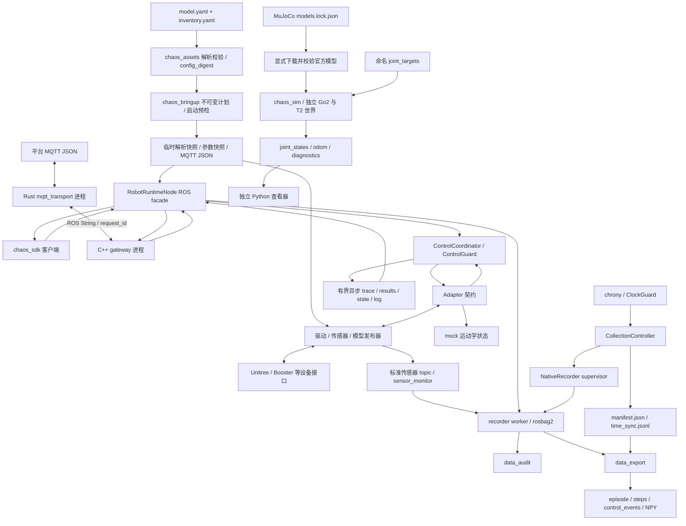
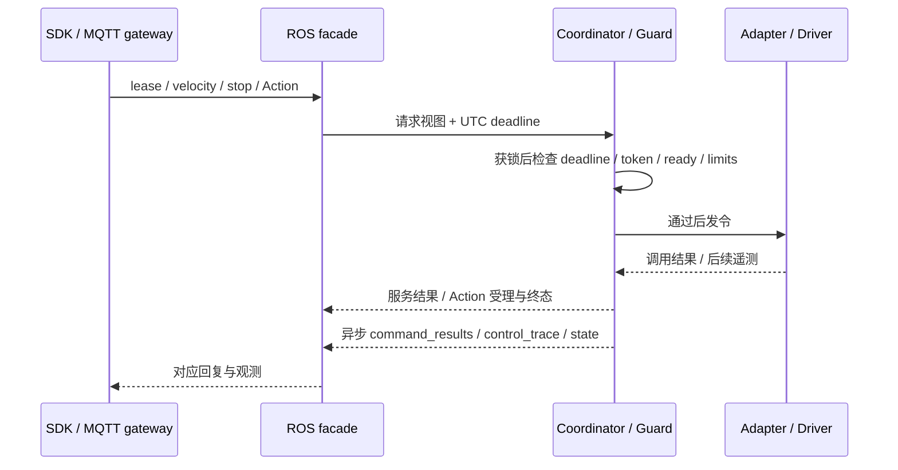

# 数据从配置到控制、采集与训练

本文按生产者、转换点和消费者说明当前实现。路径均指仓库源码；命名空间下文写作 `<ns>`，由资产清单决定。
架构边界见 [architecture.md](architecture.md)，采集部署见 [data-collection.md](data-collection.md)，训练字段契约见 [training-data.md](training-data.md)。

## 配置如何变成进程

- 入口为 [system.launch.py](../src/chaos_bringup/launch/system.launch.py) 或单资产 [edge.launch.py](../src/chaos_bringup/launch/edge.launch.py)。
  YAML 先交给原生 [load_inventory](../src/chaos_assets/src/inventory.cpp)，Python 仅通过绑定组织 launch。
- `model.yaml` 定义型号版本、能力上限、限值、资源和后端；inventory 定义实例 ID、host、namespace、mode 及覆盖值。
  解析器合并配置、解析相对路径和 `package://`、校验能力/限值/资源，并为解析后的资产生成 `config_digest`。
  重复 ID、namespace、命令输出归属和 MQTT 身份等冲突在清单层检查。
- [prepare_plan / plan_inventory](../src/chaos_bringup/src/planner.cpp) 按 host 和资产选择构造计划；
  [LaunchPlan](../src/chaos_bringup/chaos_bringup/planning.py) 给 Python 调用者返回分离的数据副本，后续启动使用同一份已解析快照。
  `config_digest` 用于配置追溯，不是设备执行证明。
- [preflight](../src/chaos_bringup/src/components.cpp) 检查运行时配置、后端构建能力、可执行文件、传感器、模型和采集依赖。
  MQTT 启用时还执行真实 transport 配置检查；失败发生在任何业务节点启动之前。
  `dry_run` 输出计划，不启动节点，也不要求完成真实环境依赖检查。
- [build_launch_actions](../src/chaos_bringup/chaos_bringup/launching.py) 写临时 `resolved-assets.json`、传感器参数快照和逐资产 MQTT JSON，
  把快照路径交给各原生进程；退出时清理临时目录。需要长期证据时应显式导出资产解析结果。
- runtime、受管驱动、传感器、模型发布器和 MQTT 子进程退出会触发本机 launch 结束。
  **collector 是例外**：[on_collection_exit](../src/chaos_bringup/chaos_bringup/collection.py) 记录退出并返回空 action 列表，运行期采集失败不终止控制 launch。
  采集启动预检失败仍会阻止整次启动；launch 不负责自动恢复租约或任务。

## 控制请求如何到达适配器

- [Robot](../src/chaos_sdk/src/robot.cpp) 是原生异步 SDK；[client.py](../src/chaos_sdk/chaos_sdk/client.py) 是 Python 包装。
  SDK 直接调用 ROS 接口，MQTT 则经 gateway 转换后调用同一 facade。
- [RobotRuntimeNode](../src/chaos_runtime/src/runtime_node.cpp) 把 ROS 消息转换为非 ROS 的请求视图：
  `description` 返回能力，`control/lease` 管理控制权，`motion/velocity` 接收类型化速度，`motion/stop` 提供停止服务，导航与飞行使用 Action。
  接口定义位于 [chaos_interfaces](../src/chaos_interfaces)。
- [ControlCoordinator](../src/chaos_runtime/src/coordinator.cpp) 串行保护控制状态，检查能力、关闭状态、适配器 ready/connected、故障及待重试停止。
  [ControlGuard](../src/chaos_runtime/src/control.cpp) 校验租约 token、租约期限、速度限值、frame、源时间递增和速度有效期。
  请求截止时间在等待控制锁之前捕获，获得锁后复检，避免排队过期的请求开始执行。
- `expires_at` 是 Unix UTC 接受截止时间，限制何时可以开始执行；它不规定已接受 Action 的运行时长。
  速度另有 ROS `header.stamp` 与 `valid_for_s`：过期、未来或同一租约内重复/倒退的源时间不能续命。
  本机租约/watchdog 和等待超时使用单调时间；墙钟变化不能延长已建立的单调期限。
- coordinator 不提供通用 `request_id` 回放缓存。MQTT 去重位于 gateway/transport；直接 ROS/SDK 调用仍受租约、时间水位和当前任务状态约束。
- 通过检查后调用 [Adapter](../src/chaos_runtime/include/chaos_runtime/adapter.hpp) 的速度、停止或操作接口。
  [MockAdapter](../src/chaos_runtime/src/adapters/mock_adapter.cpp) 更新运动学状态；
  [ROS adapters](../src/chaos_runtime/src/ros_adapters.cpp) 将控制转为驱动 topic/service 并读取遥测。
- Go2 真实链路为 ROS adapter → [Go2DriverNode](../src/chaos_runtime/src/go2/go2_driver_node.cpp) →
  [Go2DriverCore](../src/chaos_runtime/src/go2_driver_core.cpp) → [Unitree SDK backend](../src/chaos_runtime/src/go2/unitree_sdk_backend.cpp)。
  人形机器人也有 mock 和真实接入： [humanoid ROS adapter](../src/chaos_runtime/src/humanoid/ros_adapter.cpp) →
  [driver node/core](../src/chaos_runtime/src/humanoid/driver_node.cpp) → [Booster T2 backend](../src/chaos_runtime/src/humanoid/booster_backend.cpp)。
  实际能力以 `description` 和后端构建开关为准；MuJoCo 使用下文的独立仿真链路。
- 失联、租约到期、速度超时、取消或驱动错误进入停止/失效处理；停止输出失败保留待重试状态并禁止新运动。
  软件零速度/停止调用和厂商 SDK 返回值不构成硬件急停或执行器动作完成证明。

“受理”表示接口接受请求；Action 终态表示运行时报告的任务结果；`ControlTrace.stage=issued` 表示运行时调用适配器。
这些阶段都不能单独证明硬件已经执行。速度通过 `<ns>/command_results` 按 `request_id` 回执，丢失回执时结果可能未知。

## MuJoCo 模型、控制与观测

- [models.lock.json](../src/chaos_sim/config/models.lock.json) 固定 Go2 / T2 官方仓库版本、文件大小与 Git blob 哈希。
  [fetch_models.py](../src/chaos_sim/tools/fetch_models.py) 显式下载或离线验证缓存；launch 只读取本地模型，不联网。
- [simulator.launch.py](../src/chaos_sim/launch/simulator.launch.py) 将模型路径与命名空间转成 `worlds_json`，
  [simulator](../src/chaos_sim/src/simulator_node.cpp) 在一个单线程 executor 内持有两个独立的 [World](../src/chaos_sim/src/world.cpp)。
- `<ns>/joint_targets` → 整条命名目标校验 → 预分配目标缓冲 → 限幅关节 PD 力矩 → `mj_step`。
  模型的重力、接触和浮动根参与动力学；控制不会直接改写根位姿。默认 0.5 秒无有效目标后捕获当前位置保持，暂停或 reset 清除旧命令。
- `mjData` → 可复用 `State` → `<ns>/joint_states`、`odom`、`diagnostics`（默认 50 Hz）。
  消息 stamp 是 ROS 节点时间，诊断 `sim_time` 才是物理时间；不会发布 `/clock`。
- [viewer.py](../src/chaos_sim/tools/viewer.py) 在独立进程加载视觉模型，读取关节和根位姿后调用 `mj_forward` 显示。
  查看器不执行物理步进。headless 节点剔除纯显示网格，每世界只持有一组 `mjModel/mjData`，单次调度最多补 8 个基础 tick。
- 这条链路提供物理与关节控制，尚未连接统一 runtime/SDK/MQTT、资产采集计划或训练动作标签。
  T2 尚无平衡策略，会在重力下倒地；不能将关节 PD 当作速度行走控制。构建和运行见 [MuJoCo 说明](mujoco.md)。

## 遥测、标准传感器与异步观测

- 驱动 Odometry/厂商遥测进入 adapter snapshot，coordinator 的 `tick / publishStateLocked` 汇总为 `StateView`，
  facade 发布 `<ns>/state` 的 `RobotState`。嵌套 pose/twist 的源时间、frame 与有效位保留各自含义；外层发布时间不替代采样时间。
- [MockSensorNode](../src/chaos_sensors/src/mock_sensor_node.cpp) 或真实驱动发布标准 Image、CameraInfo、PointCloud2、LaserScan、Imu。
  合成数据复用预分配 payload，每次发布更新 stamp；这是 mock 时间语义，不是相机曝光时间。
- [SensorMonitorNode](../src/chaos_sensors/src/sensor_monitor_node.cpp) 订阅配置的流，调用 [HealthTracker](../src/chaos_sensors/src/health.cpp) 检查到达与源时间新鲜度，
  发布 `<ns>/sensors/description` 和 `<ns>/sensors/diagnostics`。诊断用于报告数据质量，不会自动把原始传感器融合进 `RobotState`。
- SDK 订阅状态并提供 Action 反馈；gateway 将 runtime 状态转为 `<ns>/mqtt/state` JSON。
  原始图像、点云留在 ROS/本机采集链路，默认 MQTT 映射不转发这些大消息。
- [ObservationService / ObservationEndpoint](../src/chaos_runtime/src/observation.cpp) 将控制热路径与 trace、results、state、log sink 分开。
  各通道由进程级服务的独立 worker 消费，生产者用 `try_lock` 尝试入队，不等待 sink 或队列空间。
- trace/results/log 使用有界队列，state 合并为最新待发送值；队满、锁竞争、关闭、超大 payload 或构造失败会计数并丢弃。
  精确容量及字节上限集中在 [observation_limits](../src/chaos_runtime/include/chaos_runtime/observation.hpp)，不能将该通道当成可靠控制日志。
- coordinator 在入队前分配 trace sequence，因此丢弃会留下序号缺口。
  ROS trace 包含 `asset_id/request_id/command/stage/code`、发令时间、单调时间和有效期；不包含控制 token。
  训练导出检查缺口，不能靠按时间排序补齐丢失事件。
- 服务拥有 sink 注册；worker 将 payload 和 sink 共享所有权移出内部锁后才调用回调、释放资源。
  endpoint 关闭后拒绝新入队；各通道退休并释放在途资源后才能复用注册槽。
  `requestStop` 停止接收并排空已接受工作；`joinFor` 成功才表示 worker 实际退出，超时仍保留线程与资源所有权。
  [runtime_shutdown](../src/chaos_runtime/src/runtime_shutdown.cpp) 负责运行时关闭协调；不能通过 detach 假装完成退出。
- facade 在首次 Action 请求、控制预留之前创建一个 `ActionWorker`，创建失败直接拒绝请求；后续任务复用该线程串行执行，关闭时停止并 join。
  SDK 使用有界反馈分发器
  [FeedbackDispatcher](../src/chaos_sdk/src/feedback_dispatcher.cpp)。线程启动/回收与请求执行是不同生命周期，空闲状态不能当成任务完成。

## MQTT 的两个进程与双向映射

- [build_adapter_config](../src/chaos_mqtt/src/adapter_config.cpp) 根据资产能力生成 `route_profile: custom`、命令路由和向外 topic 映射。
  [mqtt_transport](../src/chaos_mqtt/transport) 是 Rust 进程，负责 broker、TLS、MQTT envelope 和 ROS transport；
  [GatewayNode](../src/chaos_mqtt/src/gateway_node.cpp) 是 C++ 进程，负责业务校验、相关请求状态和统一 ROS 调用。
- 入站：`robots/<id>/commands` 的 `version/message_id/timestamp_ms/command` → transport 路由 →
  `<ns>/mqtt/command` 的 `std_msgs/String` → [parse_command](../src/chaos_mqtt/src/protocol.cpp)。
  bridge envelope 的 `bridge.request_id` 关联外部请求；gateway 校验参数、命令 TTL，再转换为 service/topic/Action。
- 出站：gateway 的 `<ns>/mqtt/command/result` → transport 相关响应 → `robots/<id>/responses`。
  `<ns>/mqtt/state`、`<ns>/mqtt/task_events` 分别映射 `robots/<id>/state`、`robots/<id>/task_events`；
  ROS String 在线上 JSON 中表现为 `data` 字符串，消费者需解析内层业务 JSON。
- Action accepted 发往 `mqtt/command/result`，`phase=accepted`；feedback 发往 `mqtt/task_events`。
  终态同时产生 `terminal=true` 的 task event 和 `phase=result` 的 command result，覆盖先前 accepted 回放结果。
  速度回复来自 runtime `command_results`，gateway 按 `request_id` 匹配后完成相关记录。
- [Correlations](../src/chaos_mqtt/src/protocol.cpp) 按 `request_id` 区分 pending/completed；同 ID 的 pending 返回已有受理状态，completed 回放缓存结果。
  completed 是有容量上限的 FIFO，无时间 TTL，也不持久化；它不比较命令内容，重启或容量淘汰后不能保证跨会话去重。
- gateway 默认请求等待 5 秒，Action accepted 后观察 300 秒；transport 生成配置默认回复等待 30 秒、Action 等待 360 秒。
  它们是不同边界的本地等待窗口，不替代 runtime 的命令接受截止时间或速度 watchdog。
  超时/断链的 `execution_state=unknown` 表示观察者不能确认远端结果，不表示任务已停止。
- transport 的状态和普通反馈可合并为最新样本，终态/控制响应使用可靠队列；这不改变上游 observation 可能已丢弃事件的事实。

## 采集、时间证据与离线训练数据

- [collector_main](../src/chaos_data/src/collector_main.cpp) 加载同一资产快照，构造 [CollectionController](../src/chaos_data/src/controller.cpp)，
  周期调用 `poll / update`。采集状态发布到 `<ns>/data_collection/status`，启用 MQTT 时映射为同名资产状态主题。
- [ChronyProbe](../src/chaos_data/src/timing.cpp) 读取 `chronyc -c -n tracking`；`ClockGuard` 综合同步质量、连续稳定样本和 wall/monotonic 差值检测墙钟跳变。
  未获准时等待；失同步或跳变关闭当前 segment，恢复稳定后新建段。显式 mock 豁免仍保留未验证时间标记。
  此门控证明主机授时证据，不证明传感器硬件采样同步。
- [NativeRecorder](../src/chaos_data/src/recorder_supervisor.cpp) 监督独立 [recorder worker](../src/chaos_data/src/recorder_worker_main.cpp)，
  通过控制通道交换启动、暂停/恢复、停止与确认，worker 用原生 rosbag2 写配置选定的话题及分卷。
  supervisor 的子进程存活/停止失败与时钟门控结果一并进入采集状态，失败不会写成正常完成。
- [Session](../src/chaos_data/src/session.cpp) 持有 `<output_dir>/<asset_id>/<session>/manifest.json`、`time_sync.jsonl` 与 `segments/`。
  manifest 保存资产/config_digest、录制配置、segment 及结束状态；时间 JSONL 保存 clock sample、epoch、门控决策和 session 收尾证据。
  原 bag 保留消息的源 stamp 与接收时间，采集器不重写成“已同步”的时间戳。
- [data_audit](../src/chaos_data/src/audit.cpp) 只读 bag，动态解码并输出报告/可选 JSONL 索引。
  索引含 `sequence/topic/type/receive_ns/source_ns/stamp_kind/frame`；序号是读取顺序，不是硬件帧号。
  `receive_ns-source_ns` 包含缓存、传输、调度与时钟差，不等于设备真实 offset；索引也不包含训练观测值。
- [data_export](../src/chaos_data/src/export_pipeline.cpp) 按 [export_profile](../src/chaos_data/src/export_profile.cpp) 指定的 episode/session/segment、
  feature 字段、单位、frame、clock domain、最大龄期和动作空间，先校验完整会话/正常关闭段及时间证据，再读取原消息。
  episode 是显式 UTC 区间，不从文件名推断任务，也不跨 segment 拼接。
- 对每个网格时刻 `t`，观测候选同时满足 `source_ns <= t` 与 `receive_ns <= t`，选最新源时间并校验有效位与龄期；
  不用未来收到的信息补观测。动作按 `ControlTrace` 的运行时发令时间及失效事件构造，可用晚到停止事件截断监督标签。
  `runtime_issued` 是动作语义，测得的机器人速度属于观测。
- 缺观测、过期或无有效动作的步骤保留无效原因；trace 序号损坏、时间倒序或完全无有效步骤等错误拒绝交付数据集。
  导出使用有界候选/图像缓存，写新目录，失败不交付部分成功结果；详细限制见训练文档及源码。
- 产物为 `dataset.json` 和 `episodes/<id>/{episode.json,steps.jsonl,control_events.jsonl}`，
  图像为 `episodes/<id>/images/<feature>/<12位消息索引>.npy`；文件名索引来自原消息定位，不是网格编号。
  [NPY writer](../src/chaos_data/src/npy.cpp) 原生写数组，保留支持编码的数值，不做有损压缩或自动深度归一化。
  这些文件供后续训练读取；当前没有 LeRobot 适配器、训练器或模型机载推理链路。
